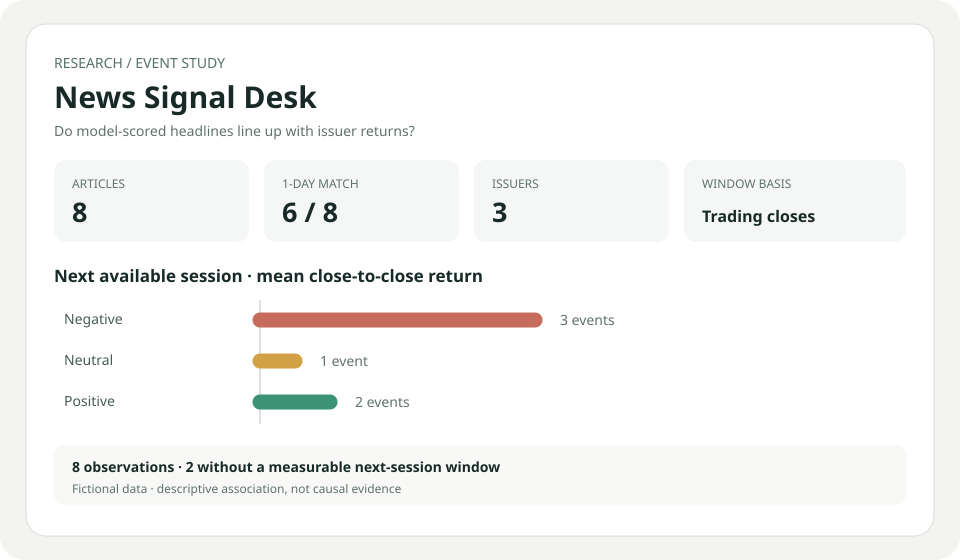

# News Signal Desk

**A headline is a hypothesis, not a trade: see how model-scored financial news lines up with what an issuer's price did next.**

News Signal Desk joins article-level sentiment scores to issuer price history, then makes the event window and missing-data decisions visible. It is a research/evaluation aid, not a sentiment model or investment signal.



## Try it

Open `index.html` in a modern browser. Nothing is uploaded or sent anywhere. Choose **Load demo**, or import the two CSV files exported by your own research pipeline. The demo uses fictional issuers, headlines, scores, and prices.

Article CSV columns: `date,ticker,headline,sentiment` (sentiment must be between -1 and 1). Price CSV columns: `date,ticker,close`. Dates use `YYYY-MM-DD`; prices must be positive. Scores can come from FinBERT or another model, but this project does not run that model.

For each article, the desk anchors on the last close on or before the article date, then measures the next 1 and 5 available closes. It displays matched coverage, forward return by sentiment bucket, rank correlation, and individual event rows. A missing anchor or horizon stays missing; it is never silently treated as a zero return. Multiple articles for the same issuer/day share the same event window and remain separate observations.

## Design notes

- **Separate model output from market outcome.** Keep the score and headline together so researchers can inspect surprising cases rather than trust a single aggregate.
- **Use trading observations, not calendar days.** A weekend article can anchor to Friday's close and the first post-publication close is the next available issuer session.
- **Expose selection effects.** Coverage counts disclose how many articles lack usable history; bucket summaries report the sample size beside the mean.
- **Make it portable.** The entire app is local HTML/JavaScript; CSV files never leave the browser.

## Checks

```bash
node --test test_news_signal.mjs
```

## Limitations

Demo data is fictional. This tool does not establish causality, account for confounders, delistings, corporate actions, liquidity, overlapping news, or trading costs. A close-to-close window may include unrelated events. Scores are treated as supplied, not validated; model calibration, source quality, look-ahead leakage, and ticker mapping remain the researcher's responsibility. Results are descriptive, not financial advice.
