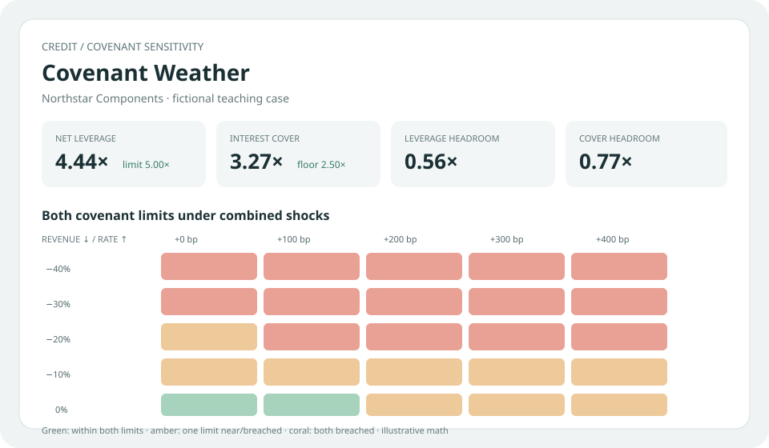

# Covenant Weather

**Change the rate or the business outlook and see which covenant clouds over first.**

Covenant Weather is a local-first credit stress map. Enter a borrower's snapshot, set a maximum net-leverage covenant and minimum interest-coverage covenant, then sweep revenue declines and floating-rate shocks to see headroom disappear. It turns a one-number risk label into an inspectable what-if conversation.



## Try it

Open `index.html` in a modern browser. Adjust the borrower snapshot or stress sliders; the baseline and full sensitivity map recalculate immediately. The preloaded “Northstar Components” case is fictional. No data is uploaded or stored.

The case takes revenue, EBITDA margin, debt, cash, current annual cash interest, share of debt at a floating rate, and the two covenant limits. Revenue decline reduces EBITDA proportionally while debt and cash stay fixed. A rate shock adds `debt × floating share × rate change` to annual interest. Net leverage is `(debt − cash) / stressed EBITDA`; interest coverage is `stressed EBITDA / stressed interest`. A cell warns if either supplied limit is breached.

## Engineering choices

- **Stress the mechanism, not a black box.** Both shock axes and each ratio's arithmetic are visible, so a reviewer can challenge the assumptions.
- **Handle domain edges deliberately.** Zero or negative stressed EBITDA cannot produce a meaningful leverage denominator; the display marks the covenant as breached instead of emitting `Infinity` or `NaN`.
- **Keep the sweep comparable.** Every grid cell uses the same snapshot and covenant limits; moving the sliders does not silently change the denominator or covenant.
- **No network, account, or package install.** One HTML/JavaScript app runs locally and the deterministic calculation layer has focused tests.

## Checks

```bash
node --test test_covenant_weather.mjs
```

## Limitations

This is a static sensitivity analysis, not a default-probability model, rating, credit opinion, or investment recommendation. A proportional revenue-to-EBITDA relationship is intentionally simple. The app holds debt, cash, margins, and base interest fixed; it does not model amortization, hedges, revolver draws, working capital, covenants' legal definitions, taxes, management actions, refinancing availability, or correlated shocks. Replace the illustrative values and verify every assumption against actual loan documents before using the framework in analysis.
