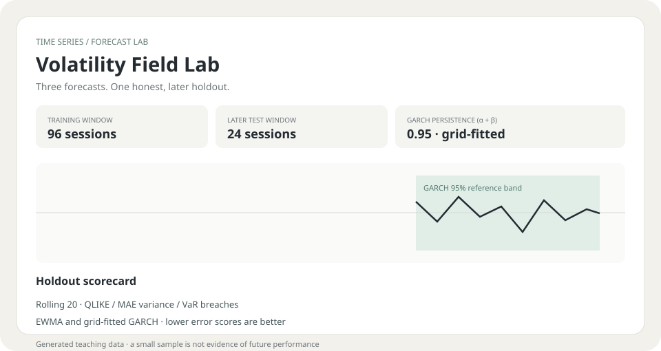

# Volatility Field Lab

**A volatility forecast only earns trust after it survives the next stretch of returns.**

Field Lab compares a 20-session rolling variance, EWMA, and a fitted GARCH(1,1) forecast on a strictly later holdout window. It reports variance forecast loss and 95% one-day VaR breaches, then produces a fresh next-session estimate. Import your own dated percentage returns or explore the deterministic fictional demo.



## Try it

Open `index.html` in a modern browser. Click **Load demo**, or choose a CSV with `date,return_pct` columns. Returns are percentage points (for example, `-1.25` means −1.25%). The demo is a generated toy series with changing volatility; it is not market data. Every calculation happens in the browser.

The newest 20% of rows (at least one) form a chronological test window. The models fit only on earlier observations. Rolling and EWMA forecasts then advance one observation at a time; GARCH parameters are estimated once on the training window and its variance state advances as each test return arrives. QLIKE and mean absolute variance error are lower-is-better comparisons; the VaR column counts test returns below the model's 95% one-day loss threshold. A final forecast is refit using all supplied observations.

## Why these three baselines?

- **Rolling variance** is an understandable window benchmark that reacts by dropping old observations.
- **EWMA (λ = 0.94)** provides a responsive industry-standard smoothing baseline.
- **GARCH(1,1)** assumes zero-mean returns and fits a small, documented parameter grid by Gaussian likelihood, constrained to a stationary persistence below 0.995. It's intentionally a transparent baseline, not an optimized production estimator.
- **No look-ahead in the scorecard.** Splitting happens by date before fitting; each holdout forecast sees only earlier realized returns.
- **Show the misses.** VaR breach counts are shown beside proper forecast scores; neither is presented as proof of calibration on a short holdout.

## Checks

```bash
node --test test_volatility_lab.mjs
```

## Limitations

Returns are assumed to be clean, equally spaced daily observations for one instrument, with zero conditional mean for the variance baselines. Missing sessions, corporate actions, stale prices, currency effects, and outliers are not repaired. Gaussian likelihood and a coarse parameter grid are educational choices; heavy tails, leverage effects, structural breaks, parameter re-estimation, transaction costs, and multi-step horizons are omitted. A 95% VaR breach count on a short holdout is noisy. Demo results are synthetic, and none of these outputs are investment advice.
